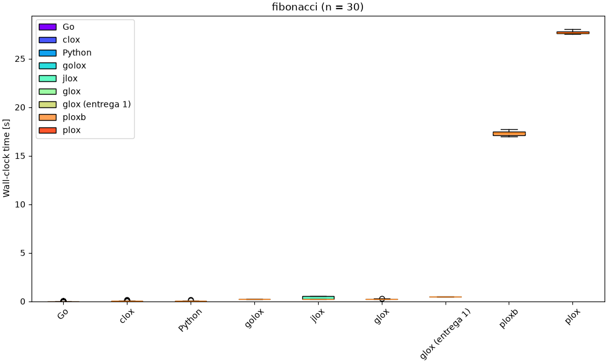
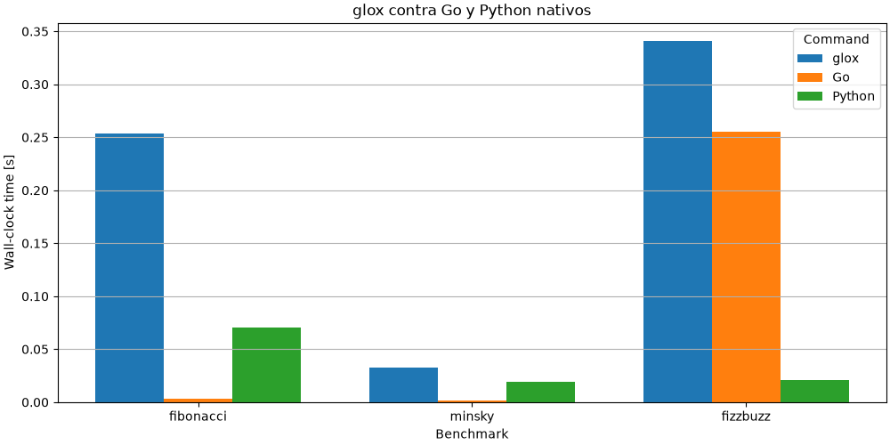
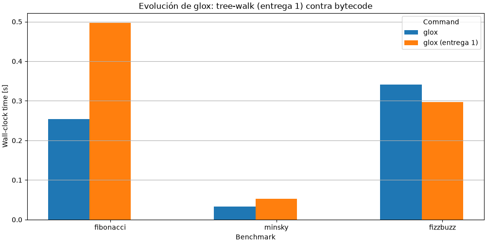

# Benchmarks

## Introducción

El objetivo de este documento es evaluar el rendimiento de _glox_, nuestra implementación de Lox en Go, y compararlo con otras implementaciones del mismo lenguaje:

| N | Implementación | Lenguaje | Técnica | Origen |
|---|---|---|---|---|
| 1 | **glox** | Go | bytecode (`--vm`) | nuestra versión final |
| 2 | **glox (entrega 1)** | Go | tree-walk | nuestra entrega parcial ([`entrega-1`](https://github.com/emiliaduzac/glox/releases/tag/entrega-1)) |
| 3 | **clox** | C | bytecode | [Crafting Interpreters](https://github.com/munificent/craftinginterpreters) |
| 4 | **jlox** | Java | tree-walk | [Crafting Interpreters](https://github.com/munificent/craftinginterpreters) |
| 5 | **plox** | Python | tree-walk | de la cátedra ([plox](https://github.com/FdelMazo/plox)) |
| 6 | **ploxb** | Python | bytecode | de la cátedra ([ploxb](https://github.com/FdelMazo/ploxb), rama `fns-and-closures`) |
| 7 | **golox** | Go | bytecode | de otro autor ([rami3l/golox](https://github.com/rami3l/golox)) |

Además, para comparar contra otros lenguajes, escribimos los mismos programas en:

| N | Lenguaje | Cómo se ejecuta | Por qué lo elegimos |
|---|---|---|---|
| 8 | **Go** | compilado a código de máquina (`go build`) | es el lenguaje en el que están hechos glox y golox |
| 9 | **Python** | CPython | es el lenguaje en el que están hechos plox y ploxb |

En general, esto podría servirnos para comparar con otras implementaciones y poder ver aspectos de ellas podrían ayudarnos a optimizar, o inlcuso comparando entre versiones propias, descubrir si los cambios realizadas realmente ayudaron a mejorar el lenguaje, ya sea en velocidad, uso de memoria o lo que fuere.

## Requisitos y set up

Para correr los benchmarks hace falta tener instalado:

- **Go**, para glox, golox y comparar contra Go mismo
- **un compilador de C y `make`**, para clox
- **Java (JDK)**, para jlox
- **[uv](https://docs.astral.sh/uv/)** y Python 3.12 o superior, para plox, ploxb y Python mismo
- **hyperfine**

El script de set up descarga y compila todas las implementaciones en `benchmarks/otros`, y compila glox y su versión de la entrega 1 (`glox-parcial`) en la raíz del repo. Se corre desde la raíz:

```bash
./benchmarks/set_up.sh
```

Para borrar todo lo que descargó y compiló:

```bash
./benchmarks/clean_up.sh
```

## Entorno

Las mediciones y resultados mostrados se obtuvieron en el siguiente entorno:

- **Máquina**: MacBook Air, Apple M4, 16 GB de RAM
- **Sistema operativo**: macOS 15.3

| Herramienta | Versión | Usada por |
|---|---|---|
| Go | 1.25.0 | glox, glox (entrega 1), golox y los programas en Go |
| Apple clang | 17.0.0 | clox |
| OpenJDK (Temurin) | 21.0.10 | jlox |
| CPython | 3.12.14 | plox, ploxb y los programas en Python |
| hyperfine | 2.0.0 | — |

## Metodología

Para medir, utilizamos la herramienta recomendada por la cátedra: [hyperfine](https://github.com/sharkdp/hyperfine), que ejecuta cada comando varias veces y reporta el **promedio**, el **desvío estándar**, el **mínimo** y el **máximo** del tiempo y también la **memoria máxima** que usó el proceso.

hyperfine mide el **tiempo total del proceso**, desde que arranca hasta que termina, incluyendo el arranque de cada implementación (el runtime de Go, la JVM o el intérprete de Python). Por eso medimos binarios ya compilados y no `go run`, que además compilaría glox en cada ejecución.

- **Corridas**: cada comando se ejecuta una vez sin medir (`--warmup 1`), y después hyperfine decide cuántas veces medirlo: al menos 10 corridas y al menos 3 segundos en total. Así, las implementaciones rápidas se miden cientos de veces, y las más lentas, 10.
- **Salida**: hyperfine descarta lo que imprime cada programa, así que no se mide el tiempo de escribir en la consola.

Los resultados se exportan a JSON y markdown (`--export-json` y `--export-markdown`) en `benchmarks/resultados/`, y los gráficos se generan a partir del JSON.

Hacemos cuatro comparaciones:

1. **glox contra otras implementaciones de Lox**: los mismos programas con las 7 implementaciones.
2. **La evolución de glox**: la versión tree-walk de la entrega 1 contra la versión final con bytecode. Además, comparamos ejecutar el binario compilado contra `go run`, que compila glox en cada ejecución. Vale la pena mencionar que la versión final sin `--vm` también es tree-walk, pero usamos el tag de la entrega 1 para medir exactamente lo que habíamos entregado
3. **Lox contra otros lenguajes**: los mismos programas escritos en **Go** y en **Python**. Elegimos esos dos porque son los lenguajes en los que están hechas glox, golox, plox y ploxb.
4. **Optimización de métodos**: medimos cuánto mejora la velocidad la optimización de `OP_INVOKE` (ver [Invoke](../docs/5-bytecode_and_vm.md#invoke)). Comparamos dos versiones del mismo programa: una que llama a los métodos normalmente, usando `OP_INVOKE`, y otra que fuerza el camino anterior a la optimización, creando un bound method en cada llamada. Como ambas se ejecutan con el mismo binario, la única diferencia es el camino de la llamada. Lo hacemos en glox y en clox, para ver si la mejora es la misma en Go que en C.

Para correr **las primeras 3** mediciones:

```bash
./benchmarks/run.sh
```

Para correr **las 4ta** medición (que fue incorporada más tarde):

```bash
./benchmarks/run_optimization.sh
```

Los gráficos se generan con los scripts de hyperfine (plot_whisker y plot_benchmark_comparison, con uvx), a partir de los JSON que están en `benchmarks/resultados/`.

### Cambios respecto de la entrega 1

En los benchmarks de la entrega 1 medimos con `time`, ejecutando cada programa 5 veces a mano, y comparamos glox con `go run`, que incluía compilar glox en cada ejecución. Además, los programas eran más cortos, así que el arranque del proceso pesaba mucho en la medición. En esta entrega pasamos a hyperfine, con más corridas y binarios compilados, y aumentamos los tamaños. Con programas más largos, el arranque pesa menos en la medición, así que dejamos de medir por separado el tiempo de ejecución con nuestra función nativa `clock()` (que solo estaba en glox).

## Programas

Usamos cuatro programas, cada uno enfocado en una parte distinta del lenguaje. `fibonacci` y `minsky` corren en las 7 implementaciones, así que solo usan lo que todas soportan: no usan `%`, `break` ni `continue`, ni clases.

- `fibonacci.lox` (n = 30): **CPU y llamadas a funciones**. El fibonacci recursivo hace unos muchísimas llamadas y cada una abre y cierra un frame.
- `minsky.lox` (n = 200000): **CPU, ciclos y condicionales**. Simula una máquina de registros con un único `while`, con asignaciones y condicionales sobre variables locales. Al ser el más corto, el arranque de cada implementación pesa más en la medición.
- `fizzbuzz.lox` (n = 100000): **memoria y strings**. Acumula el resultado en un string, y cada concatenación crea un string nuevo copiando el anterior entero. Es el que más memoria reserva y el único donde el garbage collector tiene trabajo real.
- `methods_optimized.lox` y `methods.lox`: **llamadas a métodos**. Es un programa que usa el libro para medir sus propias optimizaciones: llama a seis métodos de una instancia en cada vuelta de un ciclo, hasta sumar 100.000.000. En `methods.lox` cada llamada se escribe entre paréntesis, por ejemplo `(zoo.ant)()`, lo que hace que el compilador no use `OP_INVOKE` y se cree un bound method en cada llamada. Solo corre en glox y clox, que son las implementaciones con esta optimización.

El operador `%` es una extensión de la cátedra: lo tienen glox, plox y ploxb, pero no existe en el Lox del libro, así que clox, jlox y golox no lo soportan. Por eso `fizzbuzz` solo se compara entre las implementaciones que lo tienen.

## Hipótesis

Antes de medir, definimos algunas hipótesis que esperamos ver en los resultados:

1. **clox va a ser la más rápida entre las implementaciones de Lox**: es bytecode (gana a las versiones AST) y está escrita en C (gana a las demás versiones de bytecode en otros lenguajes)
2. **Bytecode le va a ganar a tree-walk** en los dos lenguajes en los que tenemos ambas versiones: glox VM contra glox TW (entrega 1) en Go, y ploxb contra plox en Python. La razón para implementar esta segunda versión fue para mejorar la velocidad, por lo que sería esperable que se cumpla.
3. **Las implementaciones en Python van a ser las más lentas**, porque son un intérprete corriendo sobre otro intérprete.
4. **glox VM y golox van a estar cerca**: ambos son bytecode compilers de Lox. Nos resulta interesante ver que diferencias podrían mostrar. Si las hay, deberían ser optimizaciones que alguno de los dos agregó, o decisiones de diseño.
5. **Compilar Go en cada corrida (`go run`) suma un costo fijo**. Ya lo vimos en los benchmarks de la primer entrega, donde sumaba unos 40 a 50 ms. Esperamos que se mantenga igual, porque ese costo depende de compilar glox y no del programa.
6. **`OP_INVOKE` va a mejorar la velocidad de las llamadas a métodos**, tanto en glox como en clox, porque evita crear un bound method en cada llamada. Además, el libro ya nos cuenta que el sí detecto una mejora. Esperamos que la mejora sea menor en glox, porque en Go la memoria la maneja el runtime.

## Resultados

### 1. Distintas implementaciones de Lox

**Tiempo** es el promedio ± el desvío estándar de las corridas y **Memoria**, el promedio de la memoria máxima que usó el proceso. Los datos completos de cada corrida (incluyendo el uso de CPU y las instrucciones ejecutadas) están en `benchmarks/resultados/`.

**1. Fibonacci**

| Implementación | Tiempo (ms) | Factor vs glox | Memoria (MB) |
|---|---|---|---|
| clox | **57.67** ± 15.83 | 4.40x más rápido | 1.14 |
| golox | **202.09** ± 5.17 | 1.26x más rápido | 10.53 |
| glox | **253.83** ± 1.44 | — | 9.45 |
| glox (entrega 1) | **497.30** ± 4.01 | 1.96x más lento | 11.90 |
| jlox | **360.88** ± 149.12 | 1.42x más lento | 198.25 |
| plox | **27720.15** ± 177.25 | 109.21x más lento | 29.03 |
| ploxb | **17300.09** ± 233.48 | 68.16x más lento | 29.14 |

**2. Minsky**

| Implementación | Tiempo (ms) | Factor vs glox | Memoria (MB) |
|---|---|---|---|
| clox | **5.83** ± 2.10 | 5.61x más rápido | 1.13 |
| golox | **29.09** ± 3.50 | 1.12x más rápido | 6.41 |
| glox | **32.72** ± 0.27 | — | 5.45 |
| glox (entrega 1) | **52.57** ± 5.05 | 1.61x más lento | 9.21 |
| jlox | **109.76** ± 14.67 | 3.35x más lento | 69.00 |
| plox | **3992.82** ± 37.90 | 122.03x más lento | 28.82 |
| ploxb | **2788.06** ± 417.13 | 85.21x más lento | 29.05 |

**3. Fizzbuzz**

| Implementación | Tiempo (ms) | Factor vs glox | Memoria (MB) |
|---|---|---|---|
| glox | **341.11** ± 5.01 | — | 19.40 |
| glox (entrega 1) | **297.47** ± 6.68 | 1.15x más rápido | 36.95 |
| plox | **2701.40** ± 20.10 | 7.92x más lento | 32.29 |
| ploxb | **1893.95** ± 28.26 | 5.55x más lento | 32.49 |

**Análisis**

Tanto en `fibonacci` como en `minsky`, clox fue la más rápida (lo cual era esperado). Otra cosa que destaca es que golox es siempre más rápido que nuestro glox (entre 1.12x y 1.26x), aunque usa un poco más de memoria. Como ambos son bytecode, están hechos en Go y se basan en el mismo libro, la diferencia podría venir de decisiones de implementación. Por ejemplo, nosotros nos separamos varias veces del libro apoyándonos en utilidades de Go (`map`, `any`, slices) ni implementamos un garbage collector. Habría que analizar en detalle la implementación de golox para hacer una correcta comparación.

También se cumple que ploxb es más rápido que plox, igual que glox VM es más rápido que glox TW y clox más rápido que jlox: el bytecode ayuda a agilizar, tal como anticipamos al implementar [bytecode](../docs/5-bytecode_and_vm.md). Aunque la última comparación (clox vs jlox) probablemente no se deba solamente al bytcode, sino al uso de C.

Algo que nos sorprendió mucho es es `fizzbuzz`, donde la entrega 1 (TW) es más rápida que en la versión VM. Nuestas hipótesis de porque sucede esto se explican en [Evolución de glox](#2-evolución-de-glox).

Algo esperado es que las implementaciones en Python fueron las más lentas por mucho, entre 68x y 122x más lentas que glox. En cuanto a jlox, en `minsky` que es corto, es 3.35x más lento que glox, mientras que en `fibonacci` que es más largo, su mediana (248.5 ms) es prácticamente igual a la de glox. Es algo parecido a lo que vimos en los benchmarks de la entrega 1 con `go run`: un costo fijo que pesa más cuanto más corto es el programa. En ese caso era compilar glox pero acá creemos que es el arranque de la JVM. Además, el JIT de Java que optimiza el código mientras corre, puede ser una razón que ayude.

### 2. Evolución de glox

**tree-walk vs bytecode**

| Programa | Entrega 1 (ms) | glox VM (ms) | Factor | Memoria entrega 1 (MB) | Memoria glox VM (MB) |
|---|---|---|---|---|---|
| `fibonacci` | **497.30** ± 4.01 | **253.83** ± 1.44 | 1.96x más rápido | 11.90 | 9.45 |
| `minsky` | **52.57** ± 5.05 | **32.72** ± 0.27 | 1.61x más rápido | 9.21 | 5.45 |
| `fizzbuzz` | **297.47** ± 6.68 | **341.11** ± 5.01 | 1.15x más lento | 36.95 | 19.40 |

**bytecode: binario vs go run** (con `fibonacci.lox`)

| Forma de ejecutar | Tiempo (ms) | Memoria (MB) |
|---|---|---|
| binario (`./glox --vm`) | **257.48** ± 3.63 | 9.41 |
| `go run ./cmd --vm` | **299.12** ± 13.32 | 23.43 |

**Análisis**

En `fibonacci` y `minsky`, la versión con bytecode es entre 1.61x y 1.96x más rápida que el tree-walk de la entrega 1, lo que confirma la hipótesis. Como contamos en la VM, esta recorre una secuencia plana de instrucciones en lugar de recorrer el árbol de forma recursiva y accede a las variables locales por su posición en el stack en vez de buscarlas por nombre en un `Environment`. 

Como mencionamos, la excepción es `fizzbuzz`. Al principio no identificamos bien por qué, pero luego de investigar sobre el garbage collector de Go y ver que justamente este programa usa mucha memoria, pensamos que quizá puede estar relacionado. A pesar de que la versión del TW es más rápida, también usa más memoria que la versión VM (ver en [resultados](./resultados/fizzbuzz.json)). Esto nos volvió a llamar la atención, porque lo lógico sería pensar que si usa más memoria, más trabaja el garbage collector. Pero justamente la [documentación del GC de Go](https://go.dev/doc/gc-guide#GOGC) explica que un nuevo ciclo del GC arranca cuando el heap llega a un tamaño objetivo, que depende de cuánta memoria siguió en uso después del ciclo anterior. Entonces, si la versión tree-walk tiene más memoria en uso de base (por ejemplo, por los `Environment` y el AST), el GC la deja crecer más antes de correr y correría menos veces en total.

Otro detalle a destacar es que, en los 3 programas, la versión VM usa menos memoria (entre 1.26x y 1.90x menos), incluso en `fizzbuzz`, donde es más lenta.

Por último, se mantiene la conclusión de la entrega 1: `go run` suma un costo fijo, el de **compilar glox**. En este caso fueron 41.6 ms, dentro de los 40 a 50 ms que medimos en la entrega anterior.

### 3. Lox contra otros lenguajes

**Go**

| | `fibonacci` (ms) | `minsky` (ms) | `fizzbuzz` (ms) |
|---|---|---|---|
| Go nativo | **3.58** ± 2.10 | **1.64** ± 0.20 | **255.21** ± 12.82 |
| golox | 202.09 (56.4x) | 29.09 (17.7x) | — |
| glox | 253.83 (70.9x) | 32.72 (20.0x) | 341.11 (1.34x) |

**Python**

| | `fibonacci` (ms) | `minsky` (ms) | `fizzbuzz` (ms) |
|---|---|---|---|
| Python nativo | **70.87** ± 19.32 | **19.21** ± 1.51 | **20.83** ± 0.44 |
| ploxb | 17300.09 (244.1x) | 2788.06 (145.1x) | 1893.95 (90.9x) |
| plox | 27720.15 (391.1x) | 3992.82 (207.9x) | 2701.40 (129.7x) |

**Análisis**

Como esperábamos, el lenguaje nativo es más rápido en los dos casos y por una gran diferencia que se nota mucho más en Python: las implementaciones de Lox en Go son entre 18x y 71x más lentas que Go en `fibonacci` y `minsky`, mientras que en Python son entre 90x y 391x más lentas entre los 3 programas.

Además, Python nativo le gana a glox en los tres programas. Es decir, incluso un intérprete hecho en un lenguaje compilado como Go pierde contra un lenguaje interpretado. Esto tiene sentido, ya que CPython también compila el programa a bytecode y lo ejecuta en una VM, como glox, pero está hecho en C y optimizado y sostenido constantemente.

El caso raro es `fizzbuzz`: Go nativo es solo 1.34x más rápido que glox, y Python nativo es 12x más rápido que Go. Como los programas en Go y en Python son el mismo algoritmo, la diferencia no viene de que uno haga más trabajo que el otro sino que creemos que viene de como cada lenguaje maneja la concatenación de strings.

### 4. Optimización de métodos

| Implementación | Bound method (s) | Invoke (s) | Mejora | Memoria bound (MB) | Memoria invoke (MB) |
|---|---|---|---|---|---|
| glox | **10.384** ± 0.212 | **8.771** ± 0.105 | 1.18x más rápido | 10.1 | 9.9 |
| clox | **4.580** ± 0.024 | **1.182** ± 0.007 | 3.87x más rápido | 2.3 | 1.1 |

**Análisis**

Tal como esperábamos, `OP_INVOKE` mejora la velocidad de las llamadas a métodos en las dos implementaciones: 1.18x en glox y 3.87x en clox. La diferencia en clox es mayor que en glox, por lo que creemos que se relaciona con el lenguaje de implementación.

En el uso de memoria, es bastante notorio que ambas versiones de glox utilizan bastante más que las de clox. Creemos que se relaciona con que en clox el manejo de memoria se hace explícitamente en C, mientras que en glox se suma todo el runtime de Go. Entre las dos versiones de glox la diferencia es mínima (10.1 contra 9.9 MB), pero entre las versiones de clox se nota más: la versión con bound method usa el doble (2.3 contra 1.1 MB).

El libro menciona que con esta optimización obtuvo una mejora de **7,6x**, pero nosotros obtuvimos bastante menos, incluso en clox (3.87x). No sabemos si este es el programa que se uso para medir esta optimización puntual, pero como el libro lo presenta en el capitulo de optimizaciones creemos que si. Si lo fuera, las mediciones se realizaron sobre el mismo programa, por lo que las diferencias deberían ser en cuanto a la forma de medir o el entorno usado. 

### Hipótesis

1. Creímos que clox iba a ser la más rápida y así fue: entre 4.40x y 5.61x más rápida que glox en `fibonacci` y `minsky`. En clase vimos que para mejorar la versión del AST había dos caminos: uno más general, que mira toda la computadora, como pasarnos a un lenguaje más cercano al CPU como C, y otro más particular, que cambia cómo está hecha la implementación, como pasar a bytecode. Como glox y clox ya son ambos bytecode, la diferencia entre ellos es consistente con lo que aporta el primer camino: el lenguaje en el que está escrita la implementación.

2. Creímos que Bytecode siempre iba a ganarle al tree-walk, pero no fue así. glox VM resultó entre 1.61x y 1.96x más rápido que la entrega 1, y ploxb le gana a plox en los tres programas, pero en `fizzbuzz` la entrega 1 fue más rápida que glox VM

3. Pensamos que las implementaciones en Python eran las más lentas, y fue así: entre 68x y 122x más lentas que glox. De nuevo, se relaciona con el camino mencionado en el item 1, donde el lenguaje de la implementación da una ventaja.

4. Sabíamos que glox VM y golox iban a estar cerca: golox es entre 1.12x y 1.26x más rápido, aunque usa un poco más de memoria. Podría deberse a decisiones de diseño, pero no nos profundizamos en la implementación de golox.

5. `go run` suma un costo fijo: esto se mantiene a lo que notamos de la primer entrega. Agrega 41.6 ms, lo que entra en  los 40 a 50 ms que habíamos medido.

6. `OP_INVOKE` mejoró la velocidad en las dos implementaciones, y como esperábamos, la mejora fue menor en glox (1.18x) que en clox (3.87x).



> Figura 1: comparación de las 7 implementaciones de Lox + los 2 lenguajes nativos para fibonacci con n = 30.

Podemos ver claramente cómo los lenguajes nativos son superiores. Como plox y ploxb son mucho más lentos, ocupan casi toda la escala: la diferencia con ellos muy grande pero entre las demás implementaciones (incluida clox) casi no se distingue en el gráfico.

### Otros hallazgos

- **`fizzbuzz` tiene resultados distintos a lo que esperabammos**. Es el único donde la entrega 1 le gana a glox VM. Y en los lenguajes nativos, Python fue 12x más rápido que Go. Creemos que el costo puede darse por la concatenación de strings más que por la técnica de cada implementación.
- **glox VM usa menos memoria que la entrega 1 en los tres programas**, incluso en `fizzbuzz`, donde es más lenta.
- **jlox depende mucho del largo del programa**: en `minsky` que es corto es 3.35x más lento que glox, y en `fibonacci` que es más largo su mediana es casi igual. Creemos que se debe al arranque de la JVM y a su JIT.
- **Python nativo le gana a glox en los tres programas** a pesar de ser interpretado: CPython también es una VM de bytecode, pero hecho en C.



> Figura 2: comparación entre lenguajes y glox. Vemos que `fizzbuzz` genera que Go sea más lento que Python



> Figura 3: comparación entre glox tree walk y glox bytcode para los 3 programas. Marca lo mencionado: glox VM supera a TW en `minsky` y `fibonacci`, pero no en `fizzbuzz`. Graficamente esta diferencia es muy notoria.


En resumen, glox con bytecode es entre 1.6x y 2x más rápido que nuestra entrega 1 en `fibonacci` y `minsky` (aunque no en `fizzbuzz`), y queda cerca de otra implementación de Lox en Go, aunque lejos de clox y de los lenguajes nativos.
