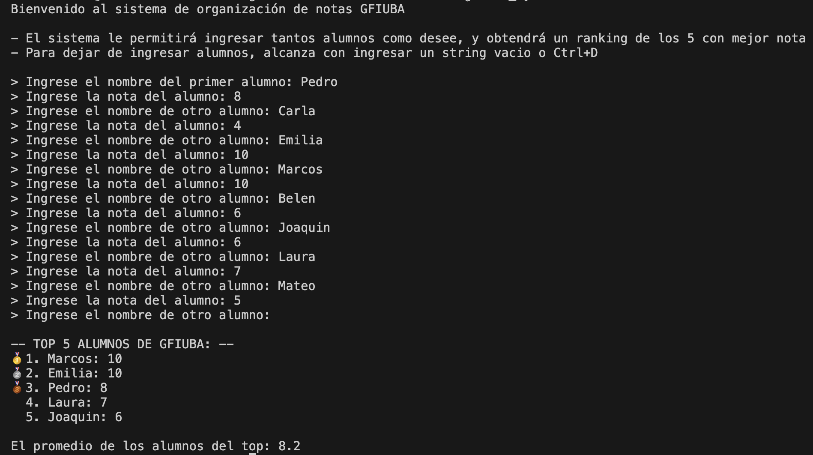

# Uso real de Glox

## 1. Algoritmos de ordenamiento 

En primer instancia, decidimos implementar los siguientes algoritmos de ordenamiento: **mergesort**, **quicksort** y **bubblesort**. Esto implicó también crear una **lista enlazada** utilizando el sistema de clases de Glox.

La clase _lista enlazada_ está compuesta por un `Nodo`, que tiene su `dato` y su `próximo`. El `dato` no tiene restricción de tipo, pero para el fin del caso de uso se usan listas de números. Al crear una `Lista`, inicializamos con los campos `primero` y `ultimo` en `nil` y `cantidad` 0. Esto nos sirve ya que en Lox los campos no se declaran, sino que se crean al usarlos. Inicializarlos al crear la lista ayuda a que luego no se generen errores en el primer uso de la lista. Lo mismo sucede al inicializar un nodo, ambos con los métodos `init`.

Implementamos los métodos típicos que tendría una lista enlazada:

- `estaVacia`: indica si tiene elementos
- `insertarPrimero`: inserta un nodo en `primero`, y hace que `primero.proximo` sea el anterior `primero`. Además, si la lista estaba vacía pasa a ser el `ultimo` también. Suma 1 a la `cantidad`.
- `insertarUltimo`: si la lista estaba vacía, el nuevo nodo será también el `primero`. Luego, hace que el anterior `ultimo` apunte a este, y este pasa a ser el nuevo `ultimo`. También suma 1 a la `cantidad`.
- `borrarPrimero`: hace que el nuevo `primero` sea el `proximo` al que era `primero`. Si esto deja la lista vacía, tanto `primero` como `ultimo` pasan a ser `nil`. Resta uno a la `cantidad` y devuelve el `dato` del eliminado.
- `verPrimero`: devuelve el `dato` del primer nodo.
- `largo`: devuelve la `cantidad` de la lista

Una vez implementada la lista enlazada, pudimos implementar los algoritmos mencionados. Por cada uno realizamos 4 tests:

1. validar que ordene una lista desordenada de 50 elementos
2. la lista vacía queda igual, no hay errores
3. una lista desordenada con elementos repetidos queda correctamente ordenada
4. una lista ya ordenada queda ordenada, también de 50 elementos

Usamos listas de 50 elementos porque quicksort, con el primer elemento como pivote, anida una llamada por elemento en el peor caso (una lista ya ordenada), y la VM admite como máximo 63 llamadas anidadas.

Para ejecutar los tests:

```bash
go run ./cmd --vm ./real-use/sorting_lists.lox
```

Todo esto puede encontrarse en [`sorting_lists.lox`](sorting_lists.lox)

## 2. Sistema de notas GFIUBA

Como otro caso de uso, y con la intención de poner a prueba glox en un programa un poco más real y divertido, implementamos un sistema de ranking de notas.

El mismo permite ingresar alumnos y sus notas hasta que el usuario no quiera ingresar más (ingresando un nombre vacío o con Ctrl+D), mediante la función nativa `input(mensaje)`. Se valida que la nota esté dentro de un rango válido (1 a 10) y al finalizar, se utiliza el algoritmo de ordenamiento `bubbleSortReverse` para ordenar los alumnos ingresados según sus notas. El programa imprime por pantalla los 5 alumnos con mejores notas y el promedio obtenido por los mismos.

Para esto, implementamos las siguientes clases, basandonos en la implementación que realizamos para los algoritmos de ordenamiento y lista enlazada:

- `Alumno`: contiene un `nombre` y una `nota`.
- `Nodo`: es un nodo de una lista enlazada, solo que en su `dato` se almacena un `Alumno`
- `ListadoAlumnos`: lista enlazada, tal cual en el caso de uso 1.

Los métodos del `ListadoAlumnos` son los mismos que los de la `Lista`, solo que tuvimos que copiarlos para poder mantener archivos separados (en glox aún no soportamos importar código de otro archivo). A su vez, adaptamos el algoritmo de ordenamiento `bubbleSort` para que use las notas de los alumnos (antes usaba el `dato` de un nodo, que debía ser un número para ordenarlo), y también para que ordene en el orden inverso, ya que nos interesan las mejores notas. Este algoritmo, en caso de empate, se queda con el último elemento.

Por último, el programa usa las otras funciones nativas que agregamos: `str` para imprimir las notas númericas, y `num` para convertir el ingreso del usuario a una nota numérica. Además, hacemos uso de los extras agregados `break` y `continue`, que nos facilitan el control de flujo en el ciclo principal del programa. Podemos seguir pidiendo notas cuando un ingreso es inválido o dejar de pedir ingresos cuando el usuario quiere finalizar.

Para ejecutar el programa:

```bash
go run ./cmd --vm ./real-use/gfiuba_system.lox
```

Todo esto puede encontrarse en [`gfiuba_system.lox`](gfiuba_system.lox)

**Ejemplo de uso**


